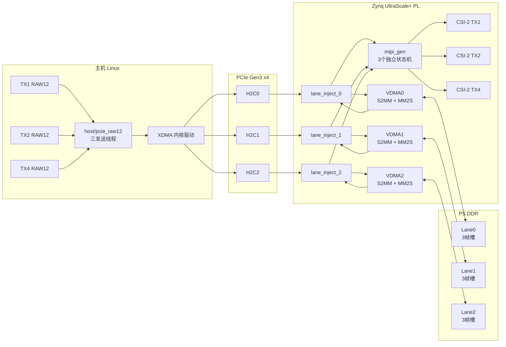
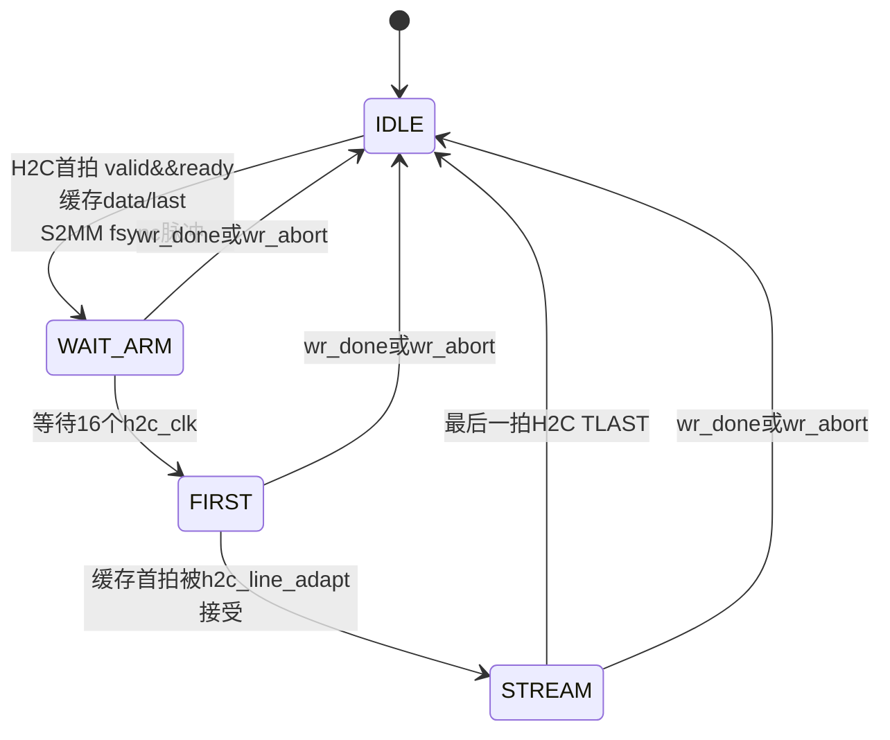
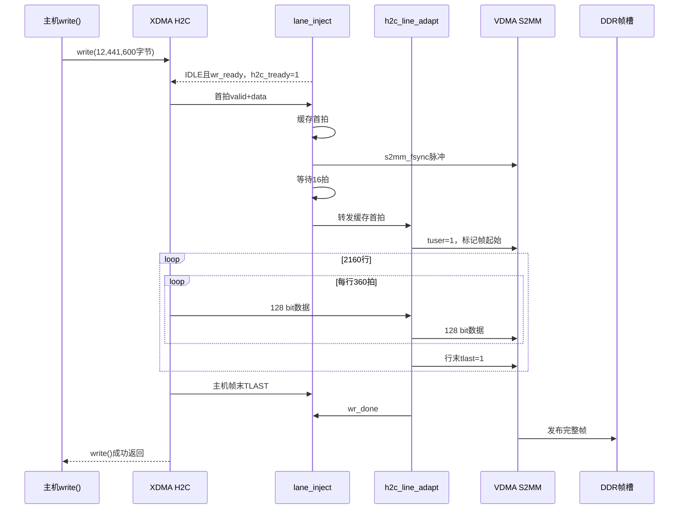
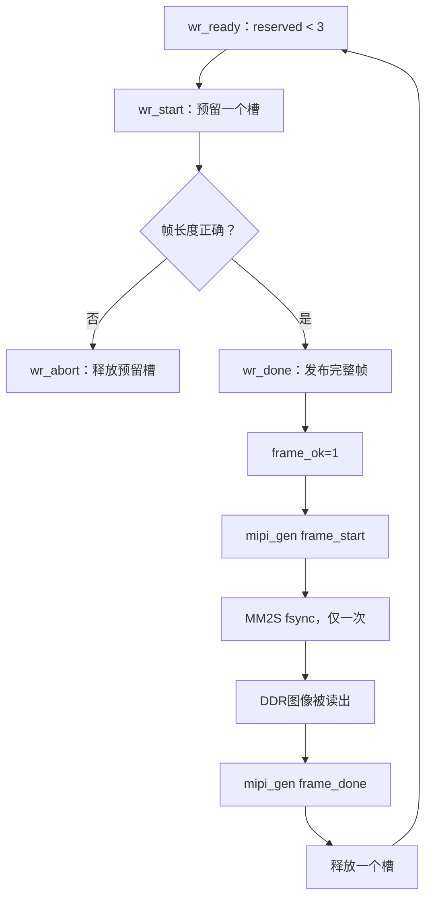
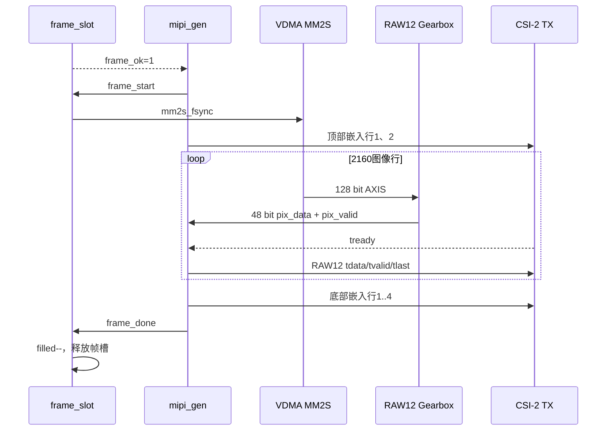
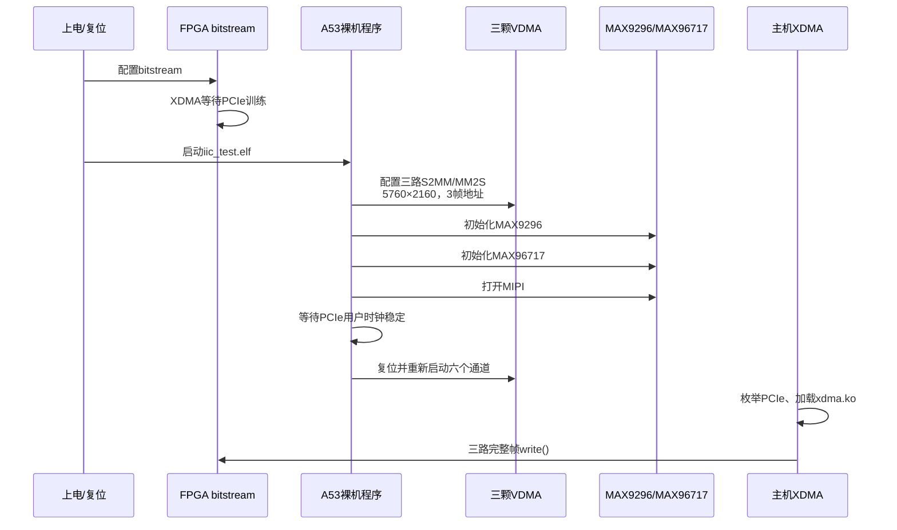

# PCIe → DDR → MIPI 三路 RAW12 注入全流程报告

> 工程：`zu4_pcie_gmsl_tx1rx1_6gloop`  
> 工具版本：Vivado / Vitis 2020.2  
> FPGA：XCZU4EV-SFVC784-2-I  
> 文档状态：板内链路、SD 冷启动和域控三路基础接收已实测；混合接入场景仍在分析
> 最后验证时间：2026-10-29

现场操作可直接阅读同目录的《PCIe → DDR → MIPI 三路注入使用说明》。

## 1. 目标与结论

本工程把主机中的三路 3840×2160 RAW12 图像，经 PCIe Gen3 x4 写入注入卡 DDR，再由三组 VDMA 读出，转换成 MIPI 发送模块所需的 48 bit 像素流，最后送入三路 CSI-2 TX。

当前已经严格证明的链路是：

```text
主机内存
  → XDMA H2C0/1/2
  → PCIe Gen3 x4
  → lane_inject 首拍缓冲与行边界适配
  → VDMA S2MM
  → Zynq DDR 三帧循环缓冲
  → VDMA MM2S
  → 128 bit / 48 bit RAW12 齿轮
  → mipi_gen
  → MIPI CSI-2 TX 的 AXI-Stream 输入
```

2026-10-28 的最终 JTAG 实测结果：

- PCIe 链路：Gen3 x4，`LnkSta = 0xf043`。
- 三路同时连续运行 30.064 秒。
- 每路完整写入 900 帧，共 2700 帧。
- 每路平均 29.94 fps。
- 总有效载荷 33,592,320,000 字节，平均 1.117 GB/s。
- 六个 VDMA 通道均处于运行状态，错误位为 0。
- ILA 记录到 fsync、H2C 握手、S2MM 握手、帧开始、帧完成和 TLAST。
- ILA 未记录到 `wr_abort`。

2026-10-29 的 SD 冷启动回归结果：

- 新 `BOOT.bin` 已包含最终 bitstream 和 `pcie3_build/iic_test.elf`。
- 主机运行中给注入卡重新上电后，Root Port 链路训练为 Gen3 x4；执行一次 rescan 后 Endpoint 枚举成功。
- Endpoint 为 `10ee:9034`，BAR0 为 `0x80e00000`，COMMAND 为 `0x0006`。
- 三路各连续完成 900 帧，测试时间 30.065 秒，无 `write()` 失败。
- 六个 VDMA 通道状态与 JTAG 测试一致，错误字段为 0。
- 本次 XDMA 驱动加载后的日志无 timeout、abort 或 IOMMU fault。

尚未由本次测试严格证明的部分：

- FPGA MIPI 物理引脚上的电气质量。
- MAX96717 串行器到域控 MAX96712 的 GMSL 物理传输。
- 域控端 nvsipl 实际收到图像且 CRC、帧号、丢帧统计均正确。

因此当前准确结论是：**新 bitstream 已打通 PCIe → DDR → MIPI TX AXIS 的三路板内数据链路，并已通过 SD 冷启动回归；外部 MIPI/GMSL/域控链路还需要接线验收。**

## 2. 整体系统结构



三路完全独立。某一路没有完整帧时，该路停止输出，不应阻塞另外两路。

## 2.1 为什么采用这个结构

### 2.1.1 先明确：DDR 不是理论上唯一的实现方式

从逻辑上说，PCIe H2C 数据可以通过异步 FIFO 直接送给 MIPI 发送模块，并不是所有 PCIe → MIPI 设计都必须经过 DDR。

但是，直通方案要求主机始终按照 MIPI 消费速度实时、连续、无抖动地供数。一旦 Linux 调度、XDMA 描述符、PCIe 流控或某一路文件读取短暂停顿，MIPI 图像行就会断流。对于本工程“三路独立、3840×2160 RAW12、约 30 fps、允许单路启停”的目标，这个条件无法可靠保证。

因此这里的“必须经过 DDR”准确含义是：**DDR 不是协议规定的必选项，但为了满足当前连续性、独立性、完整帧校验和可恢复性要求，DDR 是本设计中必要的解耦层。**

### 2.1.2 PCIe 和 MIPI 的工作方式不同

PCIe H2C 是突发式数据源：

- Linux 线程可能被调度或抢占。
- 用户缓冲区需要经过 XDMA 描述符和页映射。
- PCIe TLP、Root Port 流控和 DMA engine 会造成短时抖动。
- 三个 H2C 通道不保证每一时刻严格同步。
- `write()` 只保证最终完成，不保证每个微秒都连续供数。

MIPI 发送是受栅格时序约束的连续消费者：

- 一旦开始一帧，必须按行、按帧持续推进。
- 图像有效区不能因为主机短暂停顿而缺少像素。
- 行末、帧末、嵌入行和帧号必须位于确定位置。
- CSI-2 TX 的 `tready` 又可能反向施加短时背压。

如果把两个接口直接相连，任意一侧的抖动都会立刻传递到另一侧。DDR 把“尽快写完一整帧”和“按 MIPI 节拍稳定读出一整帧”分成两个独立过程。

### 2.1.3 DDR 在本设计中承担的作用

#### 1. 完整帧存储与校验

主机的一次 `write()` 是一帧。数据先完整写入 DDR，只有同时满足以下条件才发布给读侧：

```text
总字节数 = 12,441,600
每行 = 5,760字节
总行数 = 2,160
主机TLAST恰好出现在理论帧尾
```

错误短包或错误长包触发 `wr_abort`，不会被当作有效图像发送。

#### 2. 速率与抖动解耦

主机可以在一帧时间内突发写入；MIPI 侧按自己的像素时钟匀速读取。Linux 和 PCIe 的微秒级抖动被帧缓冲吸收，不会直接造成 MIPI 行中断。

#### 3. 时钟域隔离

写侧使用 XDMA `axi_aclk`，读侧使用 MIPI 像素时钟。VDMA 和 DDR 天然构成两个时钟域之间的帧级桥梁，避免用一个超大异步 FIFO 跨域保存整帧。

#### 4. 三路独立

三路各有独立 VDMA、HP 端口、帧槽和状态机：

- TX1 停止不会冻结 TX2/TX4。
- 某一路 CSI TX 背压不会直接阻塞另外两路 H2C。
- 三路可以使用不同图像源和不同启停时刻。

#### 5. 背压吸收

当 MIPI TX 暂时降低 `tready` 时，MM2S 和 gearbox 可以停住；已经写入 DDR 的完整帧不会丢失。只有三个帧槽全部占满后，背压才逐级传回主机。

#### 6. 可观测与可恢复

DDR 架构可以分别检查：

```text
H2C是否完成
S2MM是否正确写入
DDR内容是否正确
MM2S是否读出
mipi_gen是否完成一帧
```

直接流方案一旦出错，通常只能看到“最终没出图”，很难判断数据丢在 PCIe、跨时钟域还是 MIPI 侧。

### 2.1.4 为什么每路设计三个帧槽

一个帧槽只能保存当前帧，主机和 MIPI 不能有效重叠，任何抖动都会阻塞写入。

两个帧槽可以实现基本 ping-pong：一个写、一个读。但当读写完成事件跨时钟域同步，或者主机提前开始下一帧时，余量较小。

三个帧槽允许：

- 一个槽正在由 MIPI 读取。
- 一个槽已经写完并等待发送。
- 一个槽正在由主机写入。

因此三帧槽在延迟、内存占用和抗抖动能力之间取得平衡。每路占用约 37.3 MB，三路总计约 112 MB。

### 2.1.5 带宽核算

三路有效载荷为：

```text
单路：12,441,600 × 30 ≈ 373.25 MB/s
三路：373.25 × 3 ≈ 1.120 GB/s
```

DDR 中每个有效字节至少经历一次写入和一次读出，因此仅图像数据的 DDR 理论流量约为：

```text
1.120 GB/s写 + 1.120 GB/s读 ≈ 2.240 GB/s
```

再加上 AXI 突发、仲裁和刷新开销，仍在 Zynq DDR 与三个 128 bit HP 端口的能力范围内。最终实测 PCIe 有效载荷 1.117 GB/s，与三路约 30 fps 的理论值一致。

### 2.1.6 这个结构设计时考虑的边界条件

设计不仅考虑“正常数据能走通”，还明确处理以下边界：

- XDMA 可能等待 `tready` 后才产生 `tvalid`。
- VDMA S2MM 在 fsync 后需要启动时间。
- 主机可能发送短帧或长帧。
- CSI TX 可能等待 `tvalid` 后才产生 `tready`。
- CSI TX 在消隐区可能拉低 `tready`。
- PCIe 用户时钟可能晚于 A53 第一次 VDMA 初始化。
- 写侧和读侧处于不同时钟域。
- 三帧槽满时必须把背压传回主机。
- 单路停止不能拖住其他通道。
- PCIe 没有工作时 ILA 仍必须可访问。
- PCIe 热插拔可能破坏主机 DMA requester 状态。

### 2.1.7 采用 DDR 的代价

DDR 方案不是没有代价：

- 增加至少帧级缓存延迟。
- DDR 总带宽约为 PCIe 有效载荷的两倍。
- 增加 VDMA、地址管理和帧槽控制复杂度。
- 需要约 112 MB 连续地址空间。

如果未来目标改为“极低延迟、单路、主机为实时系统且可以严格匀速供数”，可以重新评估大异步 FIFO 直通方案。但它不适合当前三路 Linux 主机注入的稳定性目标。

## 3. 数据格式与关键参数

### 3.1 主机输入

- 图像格式：RAW12，BGGR。
- 分辨率：3840×2160。
- 一行字节数：`3840 × 12 / 8 = 5760` 字节。
- 一帧字节数：`5760 × 2160 = 12,441,600` 字节。
- 主机每次 `write()` 必须正好写一帧。
- XDMA 在每次 `write()` 的最后一拍产生 H2C `TLAST`。

#### 3.1.1 当前 MCAP 的真实数据格式

当前数据源是：

```text
/home/ubuntu/zhang/inject_system/data/1_013_20261017-120420_0.mcap
MD5：84402a7cd4f074620c0834b83fce9ffc
```

MCAP 是消息容器，不是图像像素格式。直接解析其 Header、Channel、Schema 和消息字段后确认：

- Header：`profile=""`，`library="mcap_merger.py"`。
- 相机 Channel 的 `message_encoding` 为 `cdr`。
- Schema 为 `sensor_msgs/msg/Image`，Schema 编码为 `ros2msg`。
- ROS Image 的 `encoding` 字段为 `h265`。
- `data` 从 `00 00 00 01` 开始，是 H.265 Annex B elementary stream。
- H.265 SPS 表明三路均为 HEVC Main、3840×2160、8 bit `yuv420p`、limited range。
- ROS Image 的 `height=0`、`width=0`、`step=0`；实际分辨率必须从 SPS 获取。

使用的 topic 为：

```text
/sensor/camera_forward_far/orig/h265
/sensor/camera_forward_wide/orig/h265
/sensor/camera_backward/orig/h265
```

因此，这里的 `orig/h265` 不是 Sensor Bayer RAW。MCAP 内图像已经经历：

```text
真实Sensor RAW
→ 原相机ISP
→ YUV420
→ H.265有损编码
→ ROS2 sensor_msgs/Image.data
→ MCAP封装
```

约40秒记录中，前远、前广、后视分别约为10 fps、30 fps、10 fps。转换得到398、1198、400帧；前广开头两条不带VPS的P帧被跳过。

主机发送器保持三路30Hz物理输出。为避免10Hz源被3倍速播放，lane0前远和lane2后视的每个源帧连续发送3次；lane1前广逐帧发送。该处理恢复内容时间轴，但不替代跨设备硬件FSYNC。

#### 3.1.2 H.265 到 BGGR RAW12

`host/mcap_to_raw12.py` 执行：

```text
MCAP/ROS2 CDR
→ 提取H.265 Annex B
→ FFmpeg解码为RGB24
→ RGB合成BGGR Bayer
→ 8 bit样值左移4 bit
→ 紧凑RAW12
```

BGGR采样排列为：

```text
B G
G R
```

每两个12 bit像素打包为3字节：

```text
byte0 = p0[7:0]
byte1 = {p1[3:0], p0[11:8]}
byte2 = p1[11:4]
```

这一步不会恢复压缩前的真实 Sensor RAW，只是从ISP处理后的RGB重新构造可供注入链路使用的Bayer数据。域控随后再次按 OX08D 输入执行 ISP，因此当前方案实质上存在二次 ISP；颜色响应、噪声、锐化和动态范围与真实相机不完全等价。

H.265 的 I/P 帧只影响 MCAP 解码阶段。一旦生成 RAW12，PCIe、DDR和MIPI链路看到的是逐帧独立的固定长度像素，不再包含 GOP、I帧或P帧语义。域控网页预览重新编码出的 H.265 仍可能因参考帧丢失而把上游短暂异常放大成持续花屏。

#### 3.1.3 RAW12 PNG 审计

`host/raw12_to_png.py` 对实际注入 RAW12 执行解包和 BGGR 去马赛克，PNG 仅用于人工检查，不进入发送链路。

2026-10-29 已重新生成并核对：

```text
host/audit_20261029/png_bggr_corrected/tx1_forward_far/  398张
host/audit_20261029/png_bggr_corrected/tx2_forward_wide/ 1198张
host/audit_20261029/png_bggr_corrected/tx4_backward/      400张
```

三路编号连续。旧目录 `host/audit_20261029/png/` 的预览程序曾交换红蓝通道，不能用于颜色判断；该问题不影响 RAW12 文件和硬件发送。

### 3.2 AXI-Stream 宽度

- XDMA H2C：128 bit，即每拍 16 字节。
- 每行 H2C 拍数：`5760 / 16 = 360` 拍。
- VDMA S2MM/MM2S 流宽度：128 bit。
- `mipi_gen` 像素输入：48 bit，即每拍 4 个 RAW12 像素、6 字节。
- 128/48 bit 齿轮关系：3 拍 128 bit = 48 字节，转换为 8 拍 48 bit。

### 3.3 MIPI 帧结构

`mipi_gen` 输出的有效行共 2166 行：

```text
2 行顶部嵌入数据
+ 2160 行 DDR 图像
+ 4 行底部嵌入数据
= 2166 行
```

嵌入行由 `mipi_gen` 生成，不存入 DDR。图像帧文件只包含 2160 行图像数据。

主要时序参数：

- `H_Active = 960` 个 48 bit beat，对应一行 5760 字节。
- `H_Total = 2274`。
- `V_Active = 2166`。
- `V_Total = 2200`。
- CSI-2 数据类型：`0x2c`，即 RAW12。

## 4. 地址与资源分配

### 4.1 VDMA 控制寄存器

```text
VDMA0：0x8000_0000
VDMA1：0x8002_0000
VDMA2：0x8003_0000
```

### 4.2 DDR 帧槽

每路 3 个帧槽，每个帧槽 `0x00BDD800` 字节；每路跨度 `0x02398800`。

```text
Lane0 / TX1：0x1000_0000
Lane1 / TX2：0x1239_8800
Lane2 / TX4：0x1473_1000
```

每一路的三个帧地址依次为：

```text
lane_base + 0 × 0x00BDD800
lane_base + 1 × 0x00BDD800
lane_base + 2 × 0x00BDD800
```

### 4.3 PS 高性能端口

```text
VDMA0 → SmartConnect0 → PS S_AXI_HP0_FPD
VDMA1 → SmartConnect1 → PS S_AXI_HP1_FPD
VDMA2 → SmartConnect2 → PS S_AXI_HP2_FPD
```

三路分别使用独立 HP 端口，降低三路同时读写 DDR 时的互相阻塞。

## 5. 单帧写入详细时序

### 5.1 修复前的首拍死锁

旧逻辑存在 ready-before-valid 互等：

```text
XDMA：等待下游 h2c_tready=1 后才给 h2c_tvalid
旧 RTL：等待 h2c_tvalid=1 后才发 S2MM fsync 并允许 ready
结果：valid=0、ready=0，第一拍永远不能握手
```

硬件表现为：

- 主机第一个 `write()` 超时。
- XDMA 描述符已提交但完成数为 0。
- VDMA 已运行且无错误。
- ILA 看不到 H2C valid/ready 握手。

### 5.2 修复后的状态机

`lane_inject` 增加四态首拍缓冲：



各状态行为：

1. `H2C_IDLE`
   - 只要帧槽未满，立即向 XDMA 提供 `h2c_tready=1`。
   - 首拍握手后，把 128 bit 数据和 `TLAST` 缓存在寄存器中。
   - 同拍产生一次 `s2mm_fsync`。

2. `H2C_WAIT_ARM`
   - 对 XDMA 反压。
   - 等待 16 个 H2C 时钟，使 VDMA S2MM 在 fsync 后进入接收状态。

3. `H2C_FIRST`
   - 将缓存首拍送入 `h2c_line_adapt`。
   - 首拍被接受后转入流传输状态。

4. `H2C_STREAM`
   - 后续 H2C 数据直接送入行适配器。
   - 主机帧末 `TLAST` 到达后回到空闲状态。

这个设计的关键点是：**首拍可以先从 XDMA 接走，但在 S2MM 完成 fsync 启动前不会进入 VDMA。**

### 5.3 帧写入时序图



### 5.4 行边界适配

主机 H2C 的 `TLAST` 表示整帧结束，而 VDMA S2MM 需要每行一个 `TLAST`。`h2c_line_adapt` 完成以下转换：

- 每接收 360 拍产生一次 S2MM `TLAST`。
- 第一拍产生 S2MM `TUSER`，标记帧开始。
- 第 2160 行、第 360 拍必须同时遇到主机帧末 `TLAST`。
- 主机提前给 `TLAST`：`wr_abort=1`。
- 到理论帧尾仍未见主机 `TLAST`：`wr_abort=1`。
- 帧大小完全正确：`wr_done=1`。

因此完整帧的合法条件是：

```text
H2C总拍数 = 360 × 2160 = 777,600拍
H2C总字节 = 777,600 × 16 = 12,441,600字节
```

## 6. DDR 帧槽管理时序

每路最多保留 3 帧，写时钟域和像素时钟域通过脉冲同步器交换事件。



计数含义：

- `reserved`：已经预留但尚未被 MIPI 完全消费的槽数。
- `filled`：已经写完、读侧可用的完整帧数。
- `inflight`：当前是否有一帧正在发送。

`frame_ok` 的控制保证：

- 没有完整帧时不启动 MIPI 帧。
- 有后续帧时可以在当前帧结束后无缝开始下一帧。
- 空队列不会重复播放上一帧。
- 单路停发时只影响该路。

## 7. DDR 读出与 MIPI 发送时序

### 7.1 MM2S 启动

当 `mipi_gen` 检测到 `frame_ok=1`：

1. `mipi_gen` 拉高 `frame_start`。
2. `frame_slot` 产生单周期 `mm2s_fsync`。
3. VDMA MM2S 从当前循环帧地址读取 2160×5760 字节。
4. `raw12_gearbox` 把 128 bit 流变成 48 bit 像素流。
5. 图像区只有在 `pix_valid && MIPI_TX_tready` 时推进。

### 7.2 MIPI 栅格推进规则

`mipi_gen` 对图像区、嵌入区和消隐区采用不同推进条件：

```text
图像有效区：必须 pix_valid=1 且 MIPI_TX_tready=1
嵌入有效区：必须 MIPI_TX_tready=1
水平/垂直消隐区：不依赖 tready，按像素时钟推进
```

这样可以同时避免两类死锁：

- CSI TX 可能等待 `tvalid` 才拉高 `tready`，因此帧开始不能先等 `tready`。
- 消隐期间 `tvalid=0`，CSI TX 可能拉低 `tready`，因此消隐不能等待 `tready`。

### 7.3 MIPI 读时序图



`frame_done` 只有在最后一个栅格位置真正推进时产生。持续完成远大于 3 帧的主机写入，证明 DDR 读侧持续释放帧槽，而不是只把前三帧堆进 DDR。

## 8. 时钟、复位与调试结构

### 8.1 主要时钟域

- H2C/S2MM/DDR 写侧：XDMA `axi_aclk`，目标 250 MHz。
- 像素/MM2S 输出侧：`clk_wiz_0/clk_out2`。
- VDMA AXI-Lite 控制：PS `pl_clk0`。
- ILA/VIO：PS `pl_clk0`，不挂在 XDMA 用户时钟上。

ILA/VIO 使用独立 PS 时钟非常重要：当 PCIe 用户时钟未启动时，调试核仍然可访问，可以区分“链路没有起来”和“数据逻辑没有工作”。

### 8.2 `pcie_diag` 调试桥

`pcie_diag` 把 XDMA 时钟域中的事件转换为 PS 调试时钟域中的状态和粘滞位。即使某个握手只有一个时钟周期，ILA 延后采样仍能看到“曾经发生过”。

最终 ILA 采样高 16 bit 为 `0x2bf6`，其中事件粘滞字段为 `0xfb`，表示：

- 见到 S2MM fsync。
- 见到 H2C valid/ready 握手。
- 见到 S2MM valid/ready 握手。
- 见到 `wr_start`。
- 见到 `wr_done`。
- 未见 `wr_abort`。
- 见到 S2MM 行末 `TLAST`。
- 见到 S2MM ready。

## 9. 上电和软件初始化流程



A53 程序在 GMSL 初始化后再次重启三路 VDMA，原因是第一次 VDMA 启动可能早于 PCIe 用户时钟稳定。

## 9.1 使用说明：从启动到发送

本节是现场操作的快速入口。后续章节给出每一步的详细原理和诊断方法。

### 9.1.1 当前支持的两种启动方式

#### 方式 A：JTAG 验证方式

这是当前已经完整验证的方式：

1. 通过 JTAG 下载最终 bitstream。
2. 通过 XSDB 下载 `pcie3_build/iic_test.elf`。
3. 主机确认 PCIe Gen3 x4 枚举。
4. 加载 XDMA 驱动。
5. 启动三路发送程序。

#### 方式 B：SD 冷启动方式

2026-10-29 已完成冷启动回归。SD 卡当前 `BOOT.bin` 使用本次验证通过的 bitstream 和 `pcie3_build/iic_test.elf`，可作为正式启动入口。

如果注入卡是在主机已经启动后才重新上电，Root Port 可能已训练为 Gen3 x4，但 Linux 设备树中仍没有 Endpoint。此时应对正确 Root Port 执行一次 rescan；如果注入卡与主机同时冷启动，通常由 BIOS/内核自动枚举。

### 9.1.2 第一步：确认硬件连接和操作纪律

- 注入卡正常插在主板 PCIe 插槽中。
- JTAG 线已连接。
- 串口已连接，波特率 115200。
- 不进行 PCIe 热插拔。
- 不运行旧的 `pcie_raw12` 进程。

检查残留发送程序：

```bash
pgrep -a pcie_raw12 || echo "no sender"
```

### 9.1.3 第二步：下载 bitstream

```bash
cd /data/work/gmsl_4ev/code/mipi_gmsl/zu4_pcie_gmsl_tx1rx1_6gloop
source /data/xilinx/Vivado/2020.2/settings64.sh
vivado -mode batch -source program_inject_debug.tcl
```

下载文件应为：

```text
project_1.runs/impl_tx2/design_1_wrapper.bit
MD5：7775412bc392f27ba792508ccfb9bcaf
```

### 9.1.4 第三步：运行 A53 初始化程序

不要加入 `rst -processor`：

```bash
printf '%s\n' \
  'connect -url tcp:127.0.0.1:3121' \
  'targets -set -filter {name =~ "*Cortex-A53*#0"}' \
  'stop' \
  'dow /data/work/gmsl_4ev/code/mipi_gmsl/zu4_pcie_gmsl_tx1rx1_6gloop/vitis/iic_test/pcie3_build/iic_test.elf' \
  'con' \
  'after 7000' \
  'exit' | /data/xilinx/Vitis/2020.2/bin/xsdb
```

串口应看到：

```text
vdma status
max_9296_done!
max_96717_done!
max_9296_mipien!
vdma restart after pcie clock
gmsl_debug_loop_start!
```

### 9.1.5 第四步：验证 PCIe 枚举成功

先查找 Xilinx Endpoint，不要假定 BDF 永远是 `04:00.0`：

```bash
lspci -d 10ee: -nn
lspci -t
```

本机正常应看到设备 ID `10ee:9034`。假设本次 BDF 为 `04:00.0`，继续执行：

```bash
lspci -s 04:00.0 -nnk
cat /sys/bus/pci/devices/0000:04:00.0/current_link_speed
cat /sys/bus/pci/devices/0000:04:00.0/current_link_width
```

成功标准：

```text
设备存在：10ee:9034
速度：8.0 GT/s PCIe
宽度：4
BAR0已分配
COMMAND中的Memory Space Enable和Bus Master Enable已置位
```

进一步查看：

```bash
lspci -s 04:00.0 -vv | \
  rg 'LnkCap:|LnkSta:|Region 0:|DevSta:|Kernel driver'
```

正确链路应包含：

```text
LnkSta: Speed 8GT/s, Width x4
```

如果是 Gen1、x1、设备不存在或链路处于 Training，不能继续加载驱动发送数据。

### 9.1.6 第五步：加载 XDMA 驱动

如果已经加载旧驱动，先确认没有发送进程，再卸载：

```bash
sudo rmmod xdma 2>/dev/null || true
```

加载当前驱动：

```bash
sudo insmod \
  /data/work/gmsl_4ev/code/Pcie/pcie_test/dma_ip_drivers-master/XDMA/linux-kernel/xdma/xdma.ko \
  h2c_timeout=3
```

确认驱动和节点：

```bash
lsmod | rg '^xdma'
ls -l /dev/xdma0_h2c_0 /dev/xdma0_h2c_1 /dev/xdma0_h2c_2
dmesg | rg 'xdma' | tail -n 20
```

授权当前用户：

```bash
sudo chown "$USER":"$USER" \
  /dev/xdma0_h2c_0 /dev/xdma0_h2c_1 /dev/xdma0_h2c_2
sudo chmod 660 \
  /dev/xdma0_h2c_0 /dev/xdma0_h2c_1 /dev/xdma0_h2c_2
```

成功标准：

- 三个 H2C 设备节点均存在。
- 驱动绑定到正确的 Xilinx Endpoint。
- 最新内核日志中没有 probe failure、timeout 或 IOMMU fault。

### 9.1.7 第六步：检查输入文件

三份文件大小必须都是 `12,441,600` 的整数倍：

```bash
ROOT=/data/work/gmsl_4ev/code/mipi_gmsl/zu4_pcie_gmsl_tx1rx1_6gloop

stat -c '%n %s' \
  "$ROOT/host/frames/tx1_forward_far.raw" \
  "$ROOT/host/frames/tx2_forward_wide.raw" \
  "$ROOT/host/frames/tx4_backward.raw"
```

不要用 4 KB、随机长度文件或单行数据测试 H2C。当前 RTL 把一次 `write()` 解释为一个完整图像帧。

### 9.1.8 第七步：发送三路数据

```bash
ROOT=/data/work/gmsl_4ev/code/mipi_gmsl/zu4_pcie_gmsl_tx1rx1_6gloop

"$ROOT/host/pcie_raw12" \
  "$ROOT/host/frames/tx1_forward_far.raw" \
  "$ROOT/host/frames/tx2_forward_wide.raw" \
  "$ROOT/host/frames/tx4_backward.raw"
```

发送程序创建三个线程：

```text
线程0 → /dev/xdma0_h2c_0 → TX1
线程1 → /dev/xdma0_h2c_1 → TX2
线程2 → /dev/xdma0_h2c_2 → TX4
```

正常输出：

```text
lane 0 frames 30
lane 1 frames 30
lane 2 frames 30
lane 0 frames 60
lane 1 frames 60
lane 2 frames 60
```

每一路计数应持续增长，且长期速率约 30 fps。

### 9.1.9 第八步：单路启停验证

在发送程序标准输入中执行：

```text
stop 0
```

预期：

- TX1 停止增长。
- TX2、TX4 继续增长。
- 另外两路不超时、不降为 0 fps。

结束全部发送：

```text
quit
```

### 9.1.10 第九步：检查测试期间错误

```bash
dmesg | rg -i \
  'xdma.*(timeout|fail|abort|error)|iommu.*fault|aer.*uncorrect'
```

同时按第 12 节读取 VDMA 状态并抓取 ILA。

一次合格的板内链路验证必须同时满足：

```text
PCIe = Gen3 x4
三路完整write()持续成功
三路帧数基本一致
六个VDMA错误字段为0
ILA见到fsync、H2C/S2MM握手、wr_start、wr_done、TLAST
ILA未见wr_abort
```

## 10. 构建流程

### 10.1 运行 RTL 仿真

必须至少覆盖：

- XDMA 只有看到 ready 才给 valid 的首拍场景。
- fsync 先于首拍进入 S2MM。
- 2160 行、每行 360 拍的边界。
- 错误帧触发 abort。
- 一路停止后另外两路继续。
- 全链路 RAW12 像素和嵌入行检查。

已取得的回归结果：

```text
旧 RTL：Fatal: host never observed ready
新首拍仿真：8拍数据通过，fsync一次，边界正确
tb_lane_s2mm_arm：TB_PASS fsync_cycle=0 ready_cycle=17
tb_mipi_pcie：PASS，errors=0
```

### 10.2 生成 bitstream

```bash
cd /data/work/gmsl_4ev/code/mipi_gmsl/zu4_pcie_gmsl_tx1rx1_6gloop
source /data/xilinx/Vivado/2020.2/settings64.sh
vivado -mode batch -source impl_inject_debug.tcl
```

脚本会：

1. 强制更新三路 `lane_inject` module reference。
2. 验证 ILA/VIO 使用 PS `pl_clk0`。
3. 验证调试桥接到第 0 路。
4. 重新生成 BD 和顶层 wrapper。
5. 重新执行顶层综合。
6. 检查首拍状态机和 `first_tdata` 确实进入最终网表。
7. 检查旧 `s2mm_armed` 逻辑已经消失。
8. 执行实现并生成 bitstream。

最终构建证据：

```text
H2C_STATE_CELLS 24
FIRST_DATA_CELLS 384
OLD_S2MM_ARMED_CELLS 0
IMPL_STATUS write_bitstream Complete!
WNS +0.161566 ns
WHS +0.010 ns
失败网 0
```

最终文件：

```text
project_1.runs/impl_tx2/design_1_wrapper.bit
project_1.runs/impl_tx2/design_1_wrapper.ltx
```

校验：

```text
BIT MD5：7775412bc392f27ba792508ccfb9bcaf
LTX MD5：5fcd052cc7ce68ed96fb262854a79296
```

## 11. JTAG 验证操作

### 11.1 下载 bitstream

使用工程内 `program_inject_debug.tcl`，或在 Vivado Hardware Manager 中选择：

```text
bit：project_1.runs/impl_tx2/design_1_wrapper.bit
probes：project_1.runs/impl_tx2/design_1_wrapper.ltx
```

### 11.2 下载 A53 裸机程序

不要执行 `rst -processor`，避免再次扰动已经训练好的 PCIe 状态：

```bash
printf '%s\n' \
  'connect -url tcp:127.0.0.1:3121' \
  'targets -set -filter {name =~ "*Cortex-A53*#0"}' \
  'stop' \
  'dow /data/work/gmsl_4ev/code/mipi_gmsl/zu4_pcie_gmsl_tx1rx1_6gloop/vitis/iic_test/pcie3_build/iic_test.elf' \
  'con' \
  'after 7000' \
  'exit' | /data/xilinx/Vitis/2020.2/bin/xsdb
```

### 11.3 检查 PCIe

```bash
setpci -s 00:1c.0 CAP_EXP+12.w
setpci -s 04:00.0 COMMAND.w
lspci -s 04:00.0 -nnk
```

本机当前正确值：

```text
根端口 LnkSta：f043，即 8 GT/s、x4
Endpoint Vendor：10ee
Endpoint BAR0：80e00000
Endpoint COMMAND：0006
```

PCI BDF 可能随机器或重启变化，执行任何 `setpci` 前必须先用 `lspci -t` 和 `lspci -d 10ee:` 重新确认。

### 11.4 加载驱动

```bash
sudo insmod \
  /data/work/gmsl_4ev/code/Pcie/pcie_test/dma_ip_drivers-master/XDMA/linux-kernel/xdma/xdma.ko \
  h2c_timeout=3

sudo chown "$USER":"$USER" \
  /dev/xdma0_h2c_0 /dev/xdma0_h2c_1 /dev/xdma0_h2c_2
sudo chmod 660 \
  /dev/xdma0_h2c_0 /dev/xdma0_h2c_1 /dev/xdma0_h2c_2
```

### 11.5 启动三路发送

```bash
ROOT=/data/work/gmsl_4ev/code/mipi_gmsl/zu4_pcie_gmsl_tx1rx1_6gloop

"$ROOT/host/pcie_raw12" \
  "$ROOT/host/frames/tx1_forward_far.raw" \
  "$ROOT/host/frames/tx2_forward_wide.raw" \
  "$ROOT/host/frames/tx4_backward.raw"
```

运行时标准输入命令：

```text
stop 0    停止TX1
stop 1    停止TX2
stop 2    停止TX4
quit      停止三路并退出
```

正确输出应持续出现：

```text
lane 0 frames 30
lane 1 frames 30
lane 2 frames 30
...
```

如果出现 `write returned -1`、`errno 512` 或 3 秒超时，立即停止发送并进入故障排查，不要反复热插拔。

## 12. 状态检查与验收依据

### 12.1 VDMA 状态

通过 XSDB 读取：

```tcl
foreach base {0x80000000 0x80020000 0x80030000} {
    puts [format "VDMA 0x%08X" $base]
    puts [mrd -force [expr {$base+0x00}] 2]
    puts [mrd -force [expr {$base+0x30}] 2]
}
```

最终实测三路相同：

```text
MM2S CR = 0x00010003
MM2S SR = 0x00011000
S2MM CR = 0x00010003
S2MM SR = 0x00011000
SR & 0x00000FF0 = 0
```

这表示六个通道运行，且 VDMA 错误字段为 0。

### 12.2 ILA 状态

```bash
source /data/xilinx/Vivado/2020.2/settings64.sh
vivado -mode batch -source inspect_inject_debug.tcl
```

抓取文件：

```text
/tmp/pcie_diag_capture.csv
```

最终实测 `lane_status = 0x2bf6`，粘滞事件字段 `lane_seen = 0xfb`，证明完整写入和读出相关握手均发生，且 abort 位未置位。

### 12.3 连续性判据

每路只有 3 个帧槽。如果读侧没有工作，主机最多完成 3 帧，随后 `wr_ready` 会拉低。

最终每路完成 900 帧，因此可以证明：

1. 主机 H2C 持续工作。
2. S2MM 持续把完整帧写入 DDR。
3. MM2S 持续读取 DDR。
4. RAW12 gearbox 持续向 `mipi_gen` 提供图像像素。
5. `mipi_gen` 持续走到 `frame_done`。
6. 帧槽持续释放并被下一帧复用。

但这仍不能替代域控接收端对物理 MIPI/GMSL 链路的检查。

## 13. PCIe 热插拔故障与恢复

### 13.1 现象

PCIe 热插拔后曾出现：

- 链路仍可显示 Gen3 x4。
- BAR 和 COMMAND 可恢复。
- XDMA 驱动可以加载。
- 描述符已经提交。
- 三路 H2C engine 一直 BUSY。
- `completed_desc_count=0`。
- FPGA ILA 显示 `h2c_tready=1`，但 XDMA 不产生 `h2c_tvalid`。

这说明故障不在新的 ready/valid RTL，而在热插拔后的主机 Root Port、Requester、IOMMU 或 XDMA DMA 状态。

### 13.2 已验证恢复方法

本次通过 Secondary Bus Reset、重新扫描、恢复 BAR/COMMAND、重新运行 A53 初始化和重新加载 XDMA 驱动恢复。

恢复后先进行一次完整帧测试，不要用任意 4 KB 短包验证。短包会产生非完整 RAW12 帧，可能使行适配器停在帧内状态，必须再次复位才能清除。

### 13.3 操作纪律

- 不要对正在工作的 PCIe 注入卡热插拔。
- 停机前先退出 `pcie_raw12`。
- 卸载驱动后再断电。
- 如果总线复位不能恢复，执行整机冷关机并断电，再重新上电。
- 不要在未确认 BDF 时复制执行 `setpci`。
- 不要对 NVMe 或 `/boot/efi` 所在设备执行 remove/reset。

## 14. SD BOOT 固化流程

2026-10-29 已完成 SD 固化和冷启动回归。以后重新固化时仍应先备份 SD 卡原文件，并生成带时间戳的新文件名，不覆盖历史镜像。

启动镜像包含：

```text
FSBL
+ project_1.runs/impl_tx2/design_1_wrapper.bit
+ vitis/iic_test/pcie3_build/iic_test.elf
```

现有 `iic_test_system_pcie3.bif` 的 ELF 路径仍指向 `Debug/iic_test.elf`，正式打包前必须改成已验证的 `pcie3_build/iic_test.elf`，不能直接盲用旧 BIF。

推荐生成命令：

```bash
bootgen -arch zynqmp \
  -image iic_test_system_pcie3_verified.bif \
  -o BOOT_20261029_pcie_ddr_mipi_verified.bin \
  -w
```

本次产物：

```text
BOOT MD5：001462cf7c66a07fc86b71170b543781
原BOOT备份：BOOT.bin.20261029_1011_pre_pcie_ddr_mipi
```

写入 SD 前至少核对：

```bash
md5sum project_1.runs/impl_tx2/design_1_wrapper.bit
md5sum BOOT_20261029_pcie_ddr_mipi_verified.bin
lsblk -o NAME,SIZE,TYPE,FSTYPE,LABEL,MOUNTPOINTS,MODEL
```

必须人工确认 SD 卡设备和 BOOT 分区，禁止根据固定 `/dev/sdX` 猜测。

冷启动验收：

1. 断电。
2. 插入 SD 卡。
3. 注入卡和主机正常上电，不进行 PCIe 热插拔。
4. 检查串口 A53 初始化日志。
5. 检查 Gen3 x4。
6. 加载 XDMA 驱动。
7. 三路连续发送至少 30 秒。
8. 检查 VDMA、ILA 和内核日志。
9. 再连接域控执行物理链路验收。

## 15. 域控端最终验收

接上注入卡串行器与域控解串器后，需要补齐以下证据：

- MAX96717 与 MAX96712 链路锁定。
- 域控 CSI 接口锁定。
- nvsipl 三路均约 30 fps。
- 连续运行至少 10 分钟。
- 帧号连续，无重复、回退或跳变。
- 嵌入行 CRC 错误为 0。
- CSI/GMSL CRC/ECC 错误为 0。
- 停止某一路主机发送后，只对应一路帧率变为 0。
- 恢复该路后可重新出帧，不影响另外两路。

只有以上全部通过，才可以宣布：

```text
主机 PCIe → 注入卡 DDR → FPGA MIPI → MAX96717
→ GMSL → 域控 MAX96712 → nvsipl
```

全物理链路最终完成。

## 16. 常见问题定位

### 主机第一帧就超时

检查顺序：

1. `LnkSta` 是否 Gen3 x4。
2. XDMA 驱动是否绑定到正确 Endpoint。
3. `/dev/xdma0_h2c_0..2` 是否存在且有权限。
4. ILA 中 `h2c_tready` 是否为 1。
5. ILA 中是否出现 `h2c_tvalid`。

如果 ready=1、valid=0，优先怀疑主机 DMA/Requester 状态，不要继续修改 RTL。

### 恰好发送 3 帧后停止

说明三个帧槽已写满但没有释放。检查：

- MM2S 是否启动。
- `frame_start` 是否产生。
- `mm2s_fsync` 是否只产生一次。
- gearbox 是否有 `pix_valid`。
- MIPI TX 是否拉高 `tready`。
- `mipi_gen` 是否产生 `frame_done`。

### VDMA 出现错误位

检查：

- HSIZE、STRIDE 是否均为 5760。
- VSIZE 是否为 2160。
- 三个地址是否按 `0x00BDD800` 递增。
- H2C 每次 `write()` 是否正好 12,441,600 字节。
- 行适配后的 S2MM `TLAST` 是否每 360 拍一次。

### PCIe 枚举正常但 DMA 一直 BUSY

如果发生在热插拔后：

1. 停止发送程序。
2. 卸载 XDMA。
3. 对正确 Root Port 执行 Secondary Bus Reset。
4. remove/rescan Endpoint。
5. 恢复 BAR 和 COMMAND。
6. 重新运行 A53 初始化。
7. 重新加载驱动。
8. 直接测试完整帧。
9. 仍失败则整机冷关机断电。

## 17. 关键文件索引

```text
RTL
project_1.srcs/sources_1/new/lane_inject.v
project_1.srcs/sources_1/new/h2c_line_adapt.v
project_1.srcs/sources_1/new/frame_slot.v
project_1.srcs/sources_1/new/raw12_gearbox.v
project_1.srcs/sources_1/new/mipi_gen.v
project_1.srcs/sources_1/new/pcie_diag.v

Block Design
add_pcie3.tcl
connect_inject_debug.tcl
connect_pcie_diag.tcl

构建
impl_inject_debug.tcl

JTAG
program_inject_debug.tcl
inspect_inject_debug.tcl

A53
vitis/iic_test/src/display_demo.c
vitis/iic_test/pcie3_build/iic_test.elf

主机
host/mcap_to_raw12.py
host/raw12_to_png.py
host/test_mcap_to_raw12.py
host/test_raw12_to_png.py
host/pcie_raw12.cpp
host/pcie_raw12

最终bitstream
project_1.runs/impl_tx2/design_1_wrapper.bit
project_1.runs/impl_tx2/design_1_wrapper.ltx
```

## 18. 最终结论

本次修改解决了 XDMA 与 FPGA 在帧首拍上的 ready/valid 互等，通过首拍缓存、S2MM fsync 延时和完整帧边界适配，使三路 RAW12 能够连续从主机写入 DDR，并持续经 MM2S 和 `mipi_gen` 送到三路 MIPI TX AXI-Stream 接口。

仿真、综合、实现、时序、JTAG、VDMA 和 ILA 证据相互一致。三路各 900 帧的硬件连续测试证明板内链路已打通。

三路已完成接入域控的 MIPI/GMSL/nvsipl 基础验收。当前待解决问题是“注入前远、保留真实前广”的混合接入场景中，真实前广网页预览出现周期性卡顿/花屏。离线审计已证明进入 PCIe 前的三路 RAW12 序列没有对应花屏，后续应重点区分：

1. 注入卡与真实相机只有同频、没有同相硬件帧同步，导致域控多相机时间戳匹配超时。
2. 由已处理图像合成的 RAW12 经二次 ISP 后复杂度升高，增加共享编码链路负载。
3. `nvsipl_camera` 原始采集是否连续；若原始采集正常而网页 H.265 花屏，问题位于域控编码/预览链路，反之应检查 CSI、ISP和同步逻辑。

## 19. UYVY422 独立链路版本

为兼容后续不经过域控 Bayer ISP 的注入方式，工程在保留上述 RAW12
成功版本的同时新增了独立 UYVY422 数据通路。本轮不修改域控
camera_service、SIPL 配置或 DevBlk 驱动。

### 19.1 数据结构

- 分辨率：3840×2160。
- 内存字节顺序：`U,Y0,V,Y1`。
- 每行：7680 字节。
- 每帧：16,588,800 字节。
- H2C/VDMA：128 bit，每行480拍。
- VDMA读出后由`uyvy_gearbox`转换为64 bit，每拍4像素。
- CSI-2 DT：`0x1e`。
- 顶部2行和底部4行为保留行，MIPI有效高度2166行。
- 三路30 fps主机载荷约1.493 GB/s；DDR最少写入加读出约2.986 GB/s。

```text
MCAP H.265
  → ffmpeg uyvy422
  → 三路 .uyvy422 文件
  → pcie_uyvy
  → XDMA H2C 128 bit
  → 三路 VDMA/DDR 帧槽
  → 128→64 bit UYVY gearbox
  → mipi_gen_uyvy
  → AXIS subset 64→96 bit
  → CSI-2 TX YUV422_8b
```

### 19.2 独立Block Design

`create_uyvy_bd.tcl`从已导出的RAW12设计结构创建`design_uyvy`，不覆盖
`design_1`。Vivado 2020.2完整BD校验已通过，三路参数均为：

```text
C_CSI_DATATYPE          = YUV422_8b
C_CSI_MAX_BPC           = 8
C_CSI_PIXEL_MODE        = 4
C_CSI_AXIS_TDATA_WIDTH  = 96
subset S_TDATA          = 8 bytes
subset M_TDATA          = 12 bytes
TDATA_REMAP             = 32'b0,tdata[63:0]
```

PS端通过`VIDEO_FORMAT_UYVY`选择独立参数：VDMA HSIZE/stride为7680，
单帧16,588,800字节；MAX96717/MAX9295的数据类型映射改为`0x1e`。
RAW12默认参数保持不变。

### 19.3 当前证据边界

2026-11-02使用Vivado 2020.2 xsim通过：

- `tb_uyvy_gearbox`
- `tb_lane_uyvy`
- `tb_mipi_gen_uyvy`

上位机格式、文件校验、XDMA写入策略、MCAP转换和PS格式常量测试也已
通过。Vivado实现和bitstream生成也已完成：

```text
bitstream  = project_1.runs/impl_uyvy/design_uyvy_wrapper.bit
size       = 6,297,705 bytes
SHA-256    = 49aa4e7baaf8e0bef9019e4bd0ef2d225b9ff5ca64b3cc1fd26b43c2a60bc376
WNS/TNS    = +0.161 ns / 0
WHS/THS    = +0.010 ns / 0
LUT        = 48,509 / 87,840 (55.22%)
Register   = 64,250 / 175,680 (36.57%)
BRAM       = 78.5 / 128 (61.33%)
DSP        = 0 / 728
```

所有已定义时序约束均满足。报告中的PCIe未约束端点数量与RAW12基线一致，
并非本次UYVY改动新增，但后续正式签核仍应补齐该约束。

UYVY专用PS裸机程序已使用`VIDEO_FORMAT_UYVY`编译，BOOT镜像包含
`fsbl_a53.elf`、`design_uyvy_wrapper.bit`和`iic_test_uyvy.elf`：

```text
BOOT       = vitis/iic_test_system/_ide/bootimage/BOOT_1103_UYVY.bin
size       = 6,468,168 bytes
SHA-256    = 1e6b7e16c2bad7bb2c32e3e48134649f71c35939544c48cf1d884d216eac75a5
```

当前尚未完成JTAG下载和真实硬件接收验证，因此不能用这些结果宣称域控
UYVY全链路已经打通。保留行目前发送neutral-black UYVY，精确OX08D HIL
metadata仍需后续硬件抓取确认。
